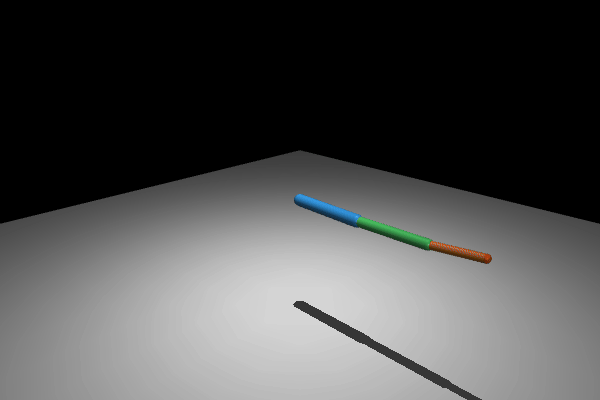
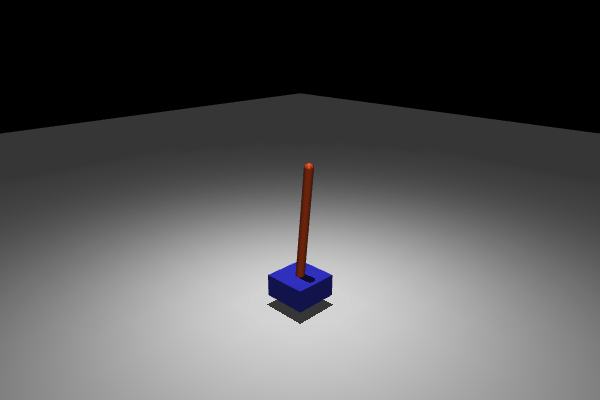
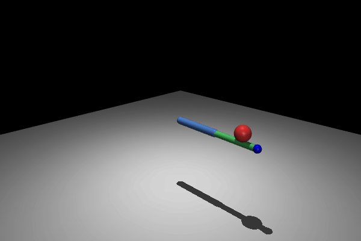
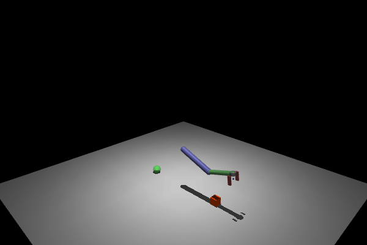

<p align="center">
    
</p>

<h1 align="center">MuJoCo Tutorial 🤖</h1>

<p align="center">
A modern tutorial for getting started with <a href="https://mujoco.org/">MuJoCo</a> — a fast, accurate physics engine for robotics, biomechanics, and reinforcement learning.
</p>

> MuJoCo is open-source (Apache 2.0) and maintained by Google DeepMind. Since v3.0, it includes GPU-accelerated simulation via MJX.

[](https://colab.research.google.com/github/tayalmanan28/MuJoCo-Tutorial/blob/main/tutorial/quickstart.ipynb)

---

## Installation 🚀

MuJoCo is a pure Python package — no license keys, no system dependencies:

```bash
pip install mujoco gymnasium[mujoco] mediapy
```

That's it. For interactive visualization you also need a display (or use offscreen rendering in notebooks).

### Optional: Conda environment

```bash
conda create -n mujoco-tut python=3.11
conda activate mujoco-tut
pip install -r requirements.txt
```

---

## Quickstart

```python
import mujoco
import mujoco.viewer

model = mujoco.MjModel.from_xml_string("""
<mujoco>
  <worldbody>
    <light pos="0 0 3" dir="0 0 -1"/>
    <geom type="plane" size="5 5 0.1"/>
    <body pos="0 0 2">
      <joint type="free"/>
      <geom type="sphere" size="0.2" rgba="1 0 0 1"/>
    </body>
  </worldbody>
</mujoco>
""")
data = mujoco.MjData(model)

# Launch interactive viewer
mujoco.viewer.launch(model, data)
```

For headless/notebook rendering, see [`examples/offscreen_rendering.py`](examples/offscreen_rendering.py).

---

## Preview

<p align="center">


</p>
<p align="center">


</p>

<p align="center"><em>Left to right: trajectory tracking, LQR balancing, impedance control, pick-and-place</em></p>

---

## Contents

| Example | Description |
|---------|-------------|
| [`examples/projectile.py`](examples/projectile.py) | Projectile with drag force |
| [`examples/pendulum_control.py`](examples/pendulum_control.py) | PD control of a pendulum |
| [`examples/double_pendulum.py`](examples/double_pendulum.py) | Double pendulum swing-up control |
| [`examples/hopper.py`](examples/hopper.py) | 2D hopper with open-loop jumping |
| [`examples/inverse_kinematics.py`](examples/inverse_kinematics.py) | Damped least-squares IK with Jacobians |
| [`examples/contact_forces.py`](examples/contact_forces.py) | Reading contact info & forces |
| [`examples/domain_randomization.py`](examples/domain_randomization.py) | Varying physics params across episodes |
| [`examples/menagerie_robot.py`](examples/menagerie_robot.py) | Loading robots from MuJoCo Menagerie |
| [`examples/mjx_parallel.py`](examples/mjx_parallel.py) | GPU-parallel sim with MJX (JAX) |
| [`examples/gymnasium_env.py`](examples/gymnasium_env.py) | Using Gymnasium's MuJoCo envs |
| [`examples/offscreen_rendering.py`](examples/offscreen_rendering.py) | Headless rendering & video export |
| [`examples/trajectory_tracking.py`](examples/trajectory_tracking.py) | Arm follows circular path (task-space PD) |
| [`examples/operational_space_control.py`](examples/operational_space_control.py) | Full dynamics compensation in task space |
| [`examples/lqr_control.py`](examples/lqr_control.py) | LQR cart-pole balancing (linearization + Riccati) |
| [`examples/impedance_control.py`](examples/impedance_control.py) | Compliant end-effector (spring-damper behavior) |
| [`examples/locomotion_controller.py`](examples/locomotion_controller.py) | Hopper FSM locomotion (finite state machine) |
| [`examples/pick_and_place.py`](examples/pick_and_place.py) | Gripper pick-and-place with waypoint sequencing |
| [`examples/record_playback.py`](examples/record_playback.py) | Save/load trajectories (record & replay) |

### Base class

[`mujoco_base.py`](mujoco_base.py) provides a minimal base class for building custom simulations:

```python
from mujoco_base import MuJoCoBase

class MySim(MuJoCoBase):
    def reset(self):
        pass  # set initial conditions

    def controller(self, model, data):
        data.ctrl[0] = ...  # your control logic

sim = MySim("my_model.xml")
sim.run()  # interactive viewer
# or
frames = sim.run_headless(duration=5.0)  # offscreen
```

---

## Tutorial Notebooks

Step-by-step Jupyter notebooks (run in Colab or locally):

| Notebook | Topic |
|----------|-------|
| [`tutorial/00_what_is_mujoco.ipynb`](tutorial/00_what_is_mujoco.ipynb) | **Start here!** What MuJoCo is, mental model, first simulation |
| [`tutorial/quickstart.ipynb`](tutorial/quickstart.ipynb) | Zero-install quickstart (Colab-ready) |
| [`tutorial/01_basics.ipynb`](tutorial/01_basics.ipynb) | MjModel, MjData, named access |
| [`tutorial/02_rendering.ipynb`](tutorial/02_rendering.ipynb) | Rendering, cameras, scenes |
| [`tutorial/03_simulation.ipynb`](tutorial/03_simulation.ipynb) | Time stepping, mj_step, mj_forward |
| [`tutorial/04_control.ipynb`](tutorial/04_control.ipynb) | Actuators, PD control, callbacks |
| [`tutorial/05_contact.ipynb`](tutorial/05_contact.ipynb) | Collision, contacts, force sensing |
| [`tutorial/06_xml_modeling.ipynb`](tutorial/06_xml_modeling.ipynb) | MJCF modeling guide |
| [`tutorial/07_mjx.ipynb`](tutorial/07_mjx.ipynb) | MJX: GPU-parallel simulation with JAX |
| [`tutorial/08_gymnasium.ipynb`](tutorial/08_gymnasium.ipynb) | MuJoCo + Gymnasium for RL |
| [`tutorial/09_sensors_and_estimation.ipynb`](tutorial/09_sensors_and_estimation.ipynb) | Sensors, IMU, noise, state estimation |
| [`tutorial/10_troubleshooting.ipynb`](tutorial/10_troubleshooting.ipynb) | Common errors & how to fix them |
| [`tutorial/interactive_control.ipynb`](tutorial/interactive_control.ipynb) | 🎮 Interactive PD tuning with sliders |

---

## Key Concepts

| Concept | Description |
|---------|-------------|
| **MJCF** | MuJoCo's XML format for defining models ([docs](https://mujoco.readthedocs.io/en/stable/XMLreference.html)) |
| **`MjModel`** | Compiled model (static) — physics parameters, geometry |
| **`MjData`** | Simulation state (dynamic) — positions, velocities, forces |
| **`mujoco.viewer`** | Built-in interactive 3D viewer |
| **`mujoco.Renderer`** | Offscreen rendering for headless environments |
| **MJX** | JAX backend for GPU-parallel simulation ([docs](https://mujoco.readthedocs.io/en/stable/mjx.html)) |

---

## Resources

- [Official MuJoCo Documentation](https://mujoco.readthedocs.io/)
- [MuJoCo GitHub](https://github.com/google-deepmind/mujoco)
- [Gymnasium MuJoCo Environments](https://gymnasium.farama.org/environments/mujoco/)
- [MuJoCo Menagerie](https://github.com/google-deepmind/mujoco_menagerie) — collection of robot models
- [MJX Tutorial](https://mujoco.readthedocs.io/en/stable/mjx.html) — GPU-accelerated simulation

---

## What's Next? 🚀

Once you've completed these tutorials, explore:

| Resource | What you'll learn |
|----------|-------------------|
| [MuJoCo Menagerie](https://github.com/google-deepmind/mujoco_menagerie) | Production-quality robot models (Franka, UR5e, Unitree, etc.) |
| [dm_control](https://github.com/google-deepmind/dm_control) | DeepMind's control suite — benchmarks for continuous control |
| [Gymnasium Leaderboard](https://gymnasium.farama.org/environments/mujoco/) | Standard RL benchmarks (HalfCheetah, Humanoid, Ant) |
| [Brax](https://github.com/google/brax) | Differentiable physics in JAX (alternative to MJX) |
| [MuJoCo XLA (MJX) Paper](https://arxiv.org/abs/2307.00282) | Technical details of GPU-parallel MuJoCo |
| [Robosuite](https://robosuite.ai/) | Manipulation benchmarks built on MuJoCo |
| [IsaacLab](https://github.com/isaac-sim/IsaacLab) | NVIDIA's sim framework (comparison point) |

---

## Contributing 🤝

1. Fork this repository
2. Create a new example in `examples/` with inline MJCF or an XML in `xml/`
3. Submit a pull request

See [CONTRIBUTING.md](CONTRIBUTING.md) for details.

---

## License 📃

MIT — free to use without restrictions.
